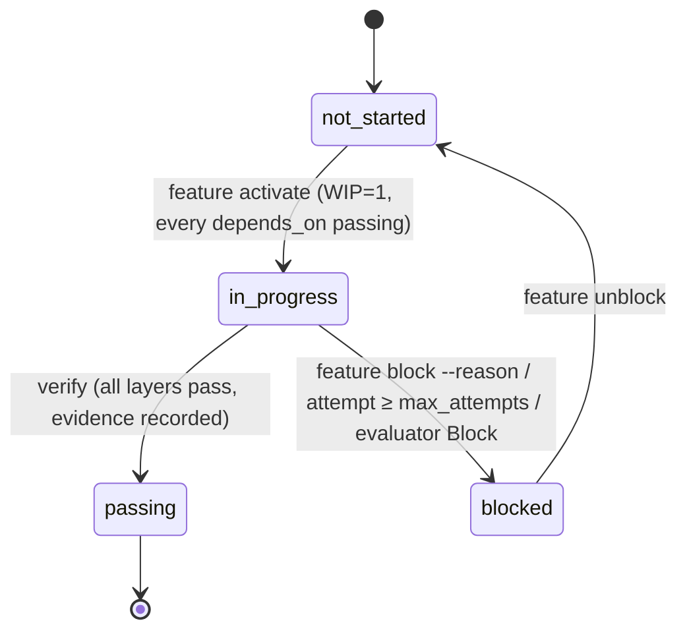

# How the harness works

The harness is the set of files, commands and hooks that let a coding agent work on a repository
one feature at a time without drifting, and let a driver run those sessions unattended. This page
explains the parts, the flow of one feature, what each safeguard catches, how to operate the
automated loop and where its limits are. Why each part exists: [why.md](why.md).

## 1. The parts

| Part               | Where                                                                                                                | Role                                                                                                                                                                                                        |
| ------------------ | -------------------------------------------------------------------------------------------------------------------- | ----------------------------------------------------------------------------------------------------------------------------------------------------------------------------------------------------------- |
| Instructions       | project: `AGENTS.md`, `CLAUDE.md`                                                                                    | The operating manual every session reads: clock-in, verification layers, constraints with `why:`, definition of done, clock-out. CLAUDE.md adds Claude Code wiring.                                         |
| State              | project: `feature_list.json`, `PROGRESS.md`, `docs/DECISIONS.md`                                                     | The queue (`depends_on`, `verification[]`, `evidence[]`), the session log, the decisions. The repository, not the chat, remembers.                                                                          |
| Configuration      | project: `harness.config.json` ([config.md](config.md))                                                              | Everything project-specific the shared parts need: ticket format, guard rules, clean-state checks, layers, services, models, caps.                                                                          |
| Verification       | project: the layer commands (`pnpm check` for L1, …)                                                                 | Named layers; a feature lists the exact commands it needs. `manual:` steps are human-only.                                                                                                                  |
| CLI                | package: `harness check / feature / verify / clean-state / loop / report / doctor`                                   | Every state transition and every gate is a command with an exit code (`pnpm harness:*`). Skills, hooks and the driver call them; nobody edits `feature_list.json` by hand.                                  |
| Claude Code wiring | plugin: skills, `harness:evaluator`, hooks · project: `.claude/settings.json`                                        | Skills (`/harness:clock-in`, `/harness:verify-feature`, `/harness:clock-out`), the evaluator agent, hooks (session-start summary, PreToolUse guard, PostToolUse formatter, opt-in Stop guard), permissions. |
| Driver             | package: `harness loop`, `prompts/`                                                                                  | Runs the loop unattended: worktree per feature, generator session, deterministic post-check, evaluator session, PR.                                                                                         |
| Observability      | project: `.harness/traces/*`, `.harness/runs.jsonl` (gitignored), PR bodies, `PROGRESS.md`                           | Full `stream-json` trace of every session, one line per run, human-readable summaries.                                                                                                                      |
| Checklists, rubric | project: `docs/harness/clean-state-checklist.md`, `evaluator-rubric.md`, `session-handoff.md`, `quality-document.md` | The judgement half of the checklists, the scoring rubric with its tuning log, handoff notes, quality grades. Templates: [../templates/](../templates/).                                                     |

## 2. One feature, two ways to run it

### Interactive (a human starts the session)

```
/harness:clock-in F-042        pnpm harness:feature next → show → activate    (WIP=1, deps passing)
   implement                   read spec and references, obey AGENTS.md constraints
/harness:verify-feature F-042  pnpm harness:verify F-042 → L1 → L2 → L3 → evidence → passing
/harness:clock-out             pnpm harness:clean-state + judgement checklist → PROGRESS.md → commit
```

### Driver-run (`pnpm harness:loop`)

```mermaid
sequenceDiagram
    participant D as Driver (harness loop)
    participant G as Generator session (claude -p --plugin-dir <package>/plugin)
    participant S as CLI (feature / verify / clean-state)
    participant E as Evaluator session (claude -p + evaluator agent as system prompt)
    participant GH as GitHub (gh)

    D->>D: preflight: default branch clean & in sync, doctor, services check + up, gh, claude + one probe per model
    D->>S: next ready feature (skip in-flight branches)
    S-->>D: F-042
    D->>D: git worktree add <worktreeRoot>/F-042 -b feat/F-042 main; FAST=1 ./init.sh
    D->>G: prompt (prompts/generator.md + project notes), env HARNESS_LOOP=1 HARNESS_STOP_GUARD=1, caps
    Note over D,G: the init event must list the harness plugin, or the session is stopped
    G->>S: /harness:clock-in → activate; implement; /harness:verify-feature → verify; clock-out → clean-state, commit
    Note over G: Stop hook blocks stopping until clean-state passes (max 3×)
    G-->>D: result line: turns, cost, denials
    D->>S: post-check in the worktree: status passing|blocked, clean-state --require-terminal, commits ahead
    alt post-check fails
        D->>S: feature attempt (auto-blocks at max_attempts) → retry with the failure appended
    end
    D->>E: evaluate F-042 (rubric, JSON schema), fresh context, read-only
    E-->>D: verdict Accept | Revise | Block + scores + findings
    alt Revise
        D->>G: retry with the findings appended
    else Block
        D->>S: feature block; push branch; notify
    else Accept
        D->>GH: git push; gh pr create (evidence, verdict, cost, trace path)
        D->>GH: wait for merge (or gh pr merge --auto --squash)
        opt auto-merge and a CI check fails (up to caps.maxCiFixAttempts fixer sessions)
            D->>GH: gh run view --log-failed → log excerpt
            D->>G: fixer session in the same worktree (prompts/ci-fixer.md + failed checks + log)
            G-->>D: fix commit, or "flaky", or feature blocked; CI-FIX-VERDICT line
            D->>S: post-check; new commit → evaluator on the fix
            D->>GH: Accept → git push (auto-merge still armed) · flaky → gh run rerun --failed once
            D->>GH: give up → gh pr merge --disable-auto, PR comment, next independent feature
        end
        D->>D: git worktree remove; git pull; next feature
    end
```

### Feature state machine



`attempts` counts driver-run sessions; `max_attempts` (feature field or `caps.maxAttempts`)
auto-blocks. `ready` = `not_started` with every dependency `passing`; the driver additionally skips
features with a `manual:` step (human-only) and features whose branch already exists on the remote
(in flight).

## 3. What each safeguard catches

| Safeguard                                           | Catches                                                                                                                                                                                                                                                                                                                               | Where                                                  |
| --------------------------------------------------- | ------------------------------------------------------------------------------------------------------------------------------------------------------------------------------------------------------------------------------------------------------------------------------------------------------------------------------------- | ------------------------------------------------------ |
| Permission allow rules (`--allowedTools`, settings) | The known-good commands run without prompts or classifier round-trips                                                                                                                                                                                                                                                                 | `harness.config.json`, project `.claude/settings.json` |
| Auto-mode classifier                                | Anything not on the allowlist is reviewed by a second model; `--permission-prompts none` denies what would have prompted                                                                                                                                                                                                              | Claude Code                                            |
| Deny rules                                          | Secrets, generated files, destructive commands — in every mode                                                                                                                                                                                                                                                                        | project `.claude/settings.json`                        |
| Guard hook (PreToolUse)                             | Core: npm/yarn/npx, force push, destructive git, `rm -rf` outside build dirs, lockfile edits, an invalid feature list before a commit; in loop mode `git push`, `checkout main`, worktree commands, writes outside the worktree, launching the `harness:evaluator` agent (the driver evaluates). Project: `guard.bash`, `guard.paths` | plugin `hooks/guard.mjs` + `guard-rules.mjs`           |
| `harness check`                                     | Two `in_progress`, `passing` without evidence, unknown or cyclic `depends_on`, `in_progress` with unmet deps, ticket format, undeclared fields                                                                                                                                                                                        | `pnpm check`, lint-staged, the guard, the driver       |
| `harness verify`                                    | A layer skipped or run out of order; services missing for a service layer; `manual:` steps waived unattended                                                                                                                                                                                                                          | the only way a feature becomes `passing`               |
| `harness clean-state`                               | Dirty tree, missing PROGRESS.md update, staged `.env`, broken restart path, plus the project's `cleanState` checks (`.only`/`.skip`, lowered coverage, debug output, marker blocks)                                                                                                                                                   | clock-out, Stop hook, driver post-check                |
| Stop hook (loop only)                               | A session ending with an unverified or uncommitted feature (max 3 blocks, respects `stop_hook_active`)                                                                                                                                                                                                                                | plugin `hooks/stop-guard.mjs`                          |
| Plugin check                                        | An unattended session that started without the guard (plugin not loaded)                                                                                                                                                                                                                                                              | `harness loop`                                         |
| Driver post-check                                   | A transcript that claims success while the branch says otherwise (status, clean-state, no commits)                                                                                                                                                                                                                                    | `harness loop`                                         |
| Evaluator (fresh context, read-only)                | Work that passes its own tests but misses the behaviour, scope creep, stale evidence, bad handoff                                                                                                                                                                                                                                     | plugin `agents/evaluator.md`, project rubric           |
| Caps                                                | Runaway sessions: turns, budget, wall clock, attempts, consecutive failures                                                                                                                                                                                                                                                           | `harness.config.json`                                  |
| CI on the PR                                        | Everything again on a clean runner                                                                                                                                                                                                                                                                                                    | project `.github/workflows/`                           |
| CI fixer                                            | A PR that passed locally but fails CI (different env, production build, runner): fixed, reviewed and pushed, re-run once if flaky, or given up with auto-merge disabled instead of hanging the loop                                                                                                                                   | `harness loop`, `prompts/ci-fixer.md`                  |

## 4. Operating the loop

**Prerequisites (once per machine and repo):** `gh` installed and logged in, the default branch
clean and in sync with the remote, the project's services startable (`services.up`). On Windows:
`winget install --id GitHub.cli`, the native `claude.exe` installer, and run the driver from Git
Bash; it runs `pnpm` through node there because the `pnpm.cmd` shim cannot be spawned without a
shell. Desktop notifications are macOS-only. With `merge: "auto"`, the default branch needs branch
protection with required CI checks, or GitHub merges the PR before CI runs. Run `claude`
interactively in the repository once and accept the trust dialog: until then Claude Code ignores
the project's `.claude/settings.json` (permissions and the plugin marketplace) and driver sessions
rely on `allowedTools` alone.

**Commands**

| Command                                   | What it does                                                                                              |
| ----------------------------------------- | --------------------------------------------------------------------------------------------------------- |
| `pnpm harness:loop --dry-run --no-docker` | Prints the worktree commands and the exact `claude` invocations for the next ready feature; runs nothing. |
| `pnpm harness:loop --once`                | One feature end to end, then stops. Use this for the first runs.                                          |
| `pnpm harness:loop --feature F-020`       | This feature only (it must be ready and unattended-capable).                                              |
| `pnpm harness:loop`                       | Loop until nothing is ready, a stop condition hits, or Ctrl-C (finishes the current session first).       |
| `--auto-merge`                            | `gh pr merge --auto --squash --delete-branch` for this run.                                               |
| `--no-wait`                               | Do not wait for the merge; continue with features that do not depend on the open PR.                      |
| `pnpm harness:report`                     | Table of past runs (feature, attempt, outcome, verdict, turns, cost, PR).                                 |
| `pnpm harness:feature list`               | Queue overview with `[ready]` / `[ready, human-only]` markers.                                            |

**Reading a run.** The console and `.harness/traces/F-NNN-<timestamp>.log` show the same readable
log (`src/events.ts` formats the stream):

- the session start with its model, permission mode and loaded plugins
- every tool call with its target (`bash: <description> · <command>`, `edit: src/…`, `skill: /harness:clock-in F-046`)
- milestones with their outcome: `▶ … started`, then `✓` done, `⚠` reported failures (output said so
  despite exit 0), `✗` failed, or `…` continues in the background. Milestones are activate, verify,
  the clean-state check, commits, and the test commands in `milestones`.
- `⛔` lines for hook blocks and denials with their reason, and `✗` for any failed tool call
- a heartbeat every 5 minutes (elapsed time, turns, output tokens, what is still running)
- the post-check problems, the evaluator's scores and findings, each CI check as it finishes, and the merge
- on red CI: `=== F-NNN CI fix 1/2`, the fixer session like a generator session, then
  `fixer says <classification> …; N new commit(s) → evaluate | rerun | retry | give-up`

`.harness/traces/F-NNN-<timestamp>.generator.jsonl` is the full stream (`--include-hook-events`, so
hook blocks are visible); the `result` line at the end carries `num_turns`, `total_cost_usd`,
`permission_denials`. A session resumed by a wakeup or a background-task notification ends each
segment with its own `result` line; `num_turns` counts only that segment, so `runs.jsonl` and the
report record the sum, while the cost is already a session total. The evaluator's JSON is next to
it, and each CI fixer session has its own
`F-NNN-<timestamp>.ci-fix.jsonl`. The PR body repeats the evidence lines, the verdict table and the
cost. `harness report` lists fixer sessions as `ci-fix` (pushed), `ci-rerun` or `failed`.

**When CI fails.** With auto-merge, a red required check does not stop the loop. The driver:

1. Fetches the failed jobs' logs (`gh run view --log-failed`) and passes an excerpt to a fixer
   session in the feature's worktree.
2. The fixer reproduces the failing step locally with the workflow's env, then classifies the
   failure. A code defect gets a `fix(F-NNN): …` commit. Flaky or infrastructure failures get no
   change. A failure outside the feature gets `harness feature block`.
3. A fix commit goes through the post-check and the evaluator. On Accept the driver pushes it;
   auto-merge is still armed. A flaky failure is re-run once (`gh run rerun --failed`), as are
   cancelled jobs, without a session.
4. This repeats up to `caps.maxCiFixAttempts` sessions per PR. Revise findings go to the next
   attempt.

If that does not get CI green, the driver gives up on that PR only. It disables auto-merge, so
nothing unreviewed merges later, pushes the branch and comments the reason and log excerpt on the
PR. It notifies you and continues with features that do not depend on it. A PR whose CI reports
nothing for 20 minutes is given up the same way. The worktree stays. To take over, fix the branch
there, push, and merge or re-enable auto-merge.

**Intervening.** Merge or close the PR (a closed PR stops the loop for that feature). Unblock a feature with
`pnpm harness:feature unblock F-NNN` after fixing the cause; lower or raise the caps in
`harness.config.json`; add an allow rule when `permission_denials` shows the same legitimate command
denied twice. After each of the first 3–5 runs, compare the evaluator's scores with your own and
record the rubric change in the project's tuning log.

**Improving the harness itself.** `harness retro` (by hand, or from the loop with `retro.every` /
`retro.onQueueEmpty`) reads these same traces, files the problems that belong to the harness or
to the project's harness setup as `harness-retro` issues, and `retro.intake` has the owning
repository's loop build them. See [self-improvement.md](self-improvement.md).

**Cost expectations.** A small library feature (unit tests only) runs in 20–60 turns and a few
dollars; a cross-component feature with L2/L3 can use a large part of the caps. Metsävahti F-046,
the first run on Windows, took two attempts, 140 minutes and about 14 USD in total.

## 5. Limits

- **Sequential only.** Projects with fixed ports for L3 or fixed container names run one feature at
  a time; services start once from the main checkout and the guard blocks starting them in a session.
- **Human-only features.** Anything with a `manual:` step stays interactive;
  `harness verify --allow-manual` is for a person who performed the step.
- **Not a sandbox.** Sessions run on the host with the classifier, the deny list and the guard as the
  boundary; `bypassPermissions` is deliberately not used. Put the driver in a container before
  raising caps or loosening the allowlist.
- **State files on branches.** Every PR touches `feature_list.json` and `PROGRESS.md`; the driver
  avoids conflicts by waiting for each PR to merge before the next dependent feature starts.
- **pnpm.** The guard, the skills and the evidence wording assume pnpm.
- **Bash write guard is a heuristic.** It recognises `mkdir`/`cp`/`mv`/`ln`/`touch`/`tee` and
  redirects into the home directory. A session can still change the host by other means, so the
  prompt rule against touching the host matters too.
- **Windows stop on timeout.** On wall-clock expiry the driver sends `SIGINT` to `claude.exe`, which
  Node maps to a hard kill on Windows. The trace may end without a `result` line; the post-check
  still catches the bad state.
- **Next stage (graph, lecture 14).** Parallel workers on features with disjoint `area` and satisfied
  `depends_on`, one worktree each with parametrised ports, an `owner` field on `in_progress` features
  and a per-worker WIP=1. History of the loop: [history/phase-2-automated-loop.md](history/phase-2-automated-loop.md).
